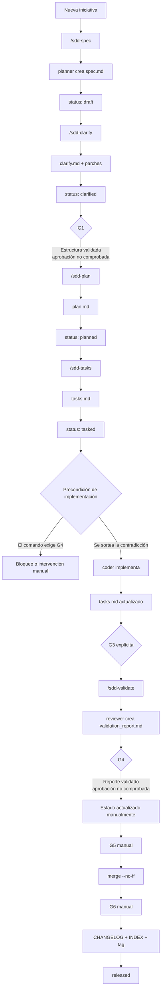
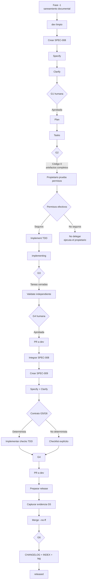

# Comparación operativa: SDD actual aplicado vs. SDD objetivo

**Proyecto:** LLaMA · **Fecha:** 2026-11-14 · **Carácter:** documento de referencia, no normativo
**Norma aplicable:** `docs/constitution.md` y `docs/sdd/PROTOCOLO_OPERATIVO.md`
**Plan comparado:** `docs/sdd/plan_cierre_brechas_sdd.md` (planificación; no ejecutado)

> Este documento compara el proceso SDD **tal como se aplica hoy** con el proceso **previsto tras ejecutar el plan de cierre de brechas**. No aprueba compuertas, no modifica requisitos y no sustituye al protocolo.

## Convención de lectura

| Etiqueta | Significado |
|---|---|
| **NORMA** | Lo que prescriben los documentos del proyecto |
| **REALIDAD** | Lo que el árbol, los agentes, los comandos y `validate.py` aplican efectivamente |
| **OBJETIVO** | Comportamiento esperado tras Fase −1, SPEC-008 y SPEC-009 |
| **CONDICIONADO** | Depende de decisiones aún abiertas o de un contrato de evidencia no aprobado |

---

# 1. Resumen ejecutivo

1. **NORMA:** el proyecto adopta SDD Spec-Anchored (`docs/constitution.md:9-18`).
2. **REALIDAD:** existen 7 specs, todas `released` en `specs/INDEX.md:7-13`, y `validate.py --all` devuelve 0.
3. **REALIDAD:** ese verde es estructural; no acredita aprobaciones humanas, transiciones de estado, G5 ni G6.
4. **REALIDAD:** G1–G4 tienen soporte documental; G5 y G6 dependen de procedimiento manual.
5. **REALIDAD:** `/sdd-implement` exige G4 donde corresponde G2 (`.opencode/commands/sdd-implement.md:8`), en contradicción con `.opencode/agents/sdd.md:88`.
6. **REALIDAD:** los permisos de `edit` pueden eludirse mediante `shell` en varios agentes.
7. **OBJETIVO:** Fase −1 sanea documentación; SPEC-008 corrige gobernanza, permisos y comandos; SPEC-009 endurece el validador.
8. **CONDICIONADO:** G5/G6 solo se automatizan si existe un contrato de evidencia determinista.
9. **LÍMITE:** el plan no cierra `CA → T`, evidencia por tarea, historial completo de transiciones, alcance del diff ni CI.
10. **VEREDICTO:** el resultado será un SDD Spec-Anchored **gobernado**, todavía no **totalmente determinista**.

---

# 2. Comparación de una página

| Dimensión | SDD actual aplicado | SDD objetivo tras el plan |
|---|---|---|
| Modelo | Spec-Anchored declarado, enforcement parcial | Spec-Anchored con controles efectivos en el alcance aprobado |
| Etapas | 7 definidas y operativas | 7 etapas con precondiciones coherentes |
| G1 | Estructura y Clarify; aprobación no verificada | Aprobación canónica en `spec.md` |
| G2 | Plan/tasks parcialmente verificados | Precondición real de implementación |
| Implementación | Comando exige G4; se detiene o requiere intervención | Exige G2; G3 se reserva al cierre |
| G3 | Solo con `--gate G3` explícito | Cierre formal de Implement |
| G4 | Reporte y filas; aprobación no verificada | Reporte, matriz y aprobación separadas |
| G5 | Manual | Determinista o checklist explícito |
| G6 | Manual | Determinista o checklist explícito |
| Estados | 10 admitidos; transiciones libres | Artefactos por estado y transiciones controladas |
| Trazabilidad | `RF/CB → CA` en WARN; resto débil | `RF/CB → CA` bloqueante; resto parcialmente fuera |
| Permisos | `edit` restringido; `shell` amplía alcance | Deny efectivo, probado antes de delegar |
| Reviewer | Expuesto a shell/subagentes | Aislado si OpenCode lo permite |
| Tests | Suite SDD segura; `tools/git/tests` muta GitHub | Gate normal exclusivamente local |
| CI | Inexistente | Sigue fuera del plan |
| Rama Gemma | Divergente y destructiva | Intacta y fuera de toda base |
| Resultado de `--all` | Verde con deuda oculta | Verde solo para lo implementado |

---

# 3. Flujo actual realmente aplicado



## Cuellos de botella

| ID | Cuello de botella | Evidencia |
|---|---|---|
| C1 | Contradicción G2/G4 en `/sdd-implement` | `.opencode/commands/sdd-implement.md:8` vs `.opencode/agents/sdd.md:88` |
| C2 | Estados sin propietario ni control de transición | `tools/sdd/validate.py:25-36` y `:299-300` |
| C3 | Aprobaciones no verificadas | `validate.py` no busca `Approved by` |
| C4 | G5 y G6 sin lógica propia | `validate.py:77-81`, `:557-563` |
| C5 | `--all` permisivo | `validate.py:383-385` |
| C6 | Permisos efectivos eludibles por shell | `.opencode/agents/*.md` |

---

# 4. Flujo objetivo del plan



---

# 5. Etapas: actual vs objetivo

| Etapa | Entrada / salida | Artefactos | Actor real hoy | Validación actual | Debilidad | Objetivo |
|---|---|---|---|---|---|---|
| Setup | Repositorio sin metodología → normas y agentes | `constitution.md`, `AGENTS.md`, `.opencode/` | Propietario | Revisión documental | Sin comprobación histórica del bootstrap | Sin cambios sustantivos |
| Specify | Iniciativa → `draft` | `spec.md`, fila en `INDEX.md` | `planner` | Frontmatter, secciones, EARS, IDs | No verifica aprobación ni unicidad global de IDs | Igual, con saneamiento documental |
| Clarify | `draft` → `clarified` | `clarify.md`, parches | `planner` | Ambigüedades, parches, sin `[ ]` | No verifica cierre efectivo de ambigüedades | Igual, con criterio explícito |
| Plan | G1 + `clarified` → `planned` | `plan.md` | `planner` | Referencias, `DEC-NNN`, mención de testing | Comprobación textual | Igual |
| Tasks | `planned` → `tasked` | `tasks.md` | `planner` | Tareas, dependencias, cobertura parcial | No verifica `CA → T` | Cobertura `RF/CB → CA` bloqueante desde G2 |
| Implement | `tasked` → `implementing` / `implemented` | Código, tests, `tasks.md` | `coder` | TDD declarado, G3 explícita | Comando exige G4 | Exige G2; G3 solo al cierre |
| Validate | G3 → `validated` | `validation_report.md` | `reviewer` | Dictamen y filas reconocidas | Sin aprobación ni matriz obligatoria | Matriz y aprobación separadas |
| Integrate | Spec validada → merge | Merge commit, evidencia | Propietario/GitHub | `--git` limitado | No vincula merge con spec | G5 determinista o checklist |
| Release | Integración → `released` | `CHANGELOG.md`, `INDEX.md`, tag | Propietario | Procedimiento manual | Sin G6 verificable | G6 determinista o checklist |

---

# 6. Compuertas G1–G6

| Gate | Condición normativa | Aplicación real hoy | Objetivo | Responsable |
|---|---|---|---|---|
| **G1** | Spec sin ambigüedades, EARS correcto y aprobación (`PROTOCOLO_OPERATIVO.md:37-40`) | Estructura y Clarify; la aprobación no se comprueba | Aprobación canónica en `spec.md`, formato tolerante y fecha ISO | Propietario |
| **G2** | Plan y tasks conformes, cobertura 100 % (`:40`) | Plan/tasks y cobertura parcial | Precondición verificable de implementación | `sdd` ejecuta; propietario decide transición |
| **G3** | Todas las tareas `[x]` con evidencia y TDD verde (`:41`) | Solo con `--gate G3`; `--all` no lo deriva del estado | Cierre formal de Implement | Procedimiento |
| **G4** | Reporte convergido al 100 % y aprobación (`:42`) | Reporte y filas; sin aprobación ni matriz garantizada | Reporte + matriz + aprobación canónica | Propietario aprueba |
| **G5** | `merge --no-ff`, validación posterior, rama eliminada (`:43`) | Sin lógica propia | Contrato determinista de integración o checklist | Propietario / Git |
| **G6** | Autorización, tag anotado, `INDEX.md` y `CHANGELOG.md` (`:44`) | Sin lógica propia | Validación conjunta si el contrato lo permite | Propietario |

## Diferencia esencial

```text
ACTUAL
G1 ≈ validación estructural
G2 ≈ plan/tasks
G3 ≈ tareas marcadas
G4/G5/G6 ≈ reporte de validación

OBJETIVO
G1 = Clarify + aprobación
G2 = Plan + Tasks + cobertura
G3 = Implement cerrada
G4 = Validate + aprobación
G5 = Integración demostrable
G6 = Release demostrable + aprobación
```

## Incoherencia crítica actual

| Fuente | Afirmación |
|---|---|
| `PROTOCOLO_OPERATIVO.md:40-42` | G2 cierra Tasks; G4 cierra Validate |
| `.opencode/agents/sdd.md:88` | Implement requiere G2 |
| `.opencode/commands/sdd-implement.md:8` | Implement requiere G4 |
| `.opencode/commands/sdd-implement.md:13` | Valida G3 por tarea individual |

Consecuencia: el comando se detiene ante una spec recién `tasked`, y la compuerta de cierre se usa como validación unitaria.

---

# 7. Máquina de estados

## Estados admitidos

`draft`, `clarified`, `planned`, `tasked`, `implementing`, `implemented`, `validated`, `released`, `superseded`, `cancelled` (`tools/sdd/validate.py:25-36`).

## Máquina normativa

```text
draft → clarified → planned → tasked → implementing → implemented → validated → released

draft / clarified / planned / tasked → cancelled
validated → implementing      [reapertura con motivo y nueva versión]
validated / released → superseded
```

Fuente: `docs/sdd/PROTOCOLO_OPERATIVO.md:23-33`.

## Aplicación real vs objetivo

| Aspecto | Realidad actual | Objetivo |
|---|---|---|
| Fuente del estado | Frontmatter de `spec.md` | Igual, con `INDEX.md` contrastado |
| Escritura | `planner` puede escribir todo `specs/**` | Responsable explícito por transición |
| Transiciones | No validadas; solo pertenencia al conjunto | Controladas en el alcance aprobado |
| `implementing` / `implemented` / `validated` | Sin comando que los escriba | Definidos en protocolo; escritura manual o comando autorizado |
| Reapertura | Descrita, no verificada | Motivo, versión y revalidación |
| Sustitución | Campos presentes, sin validación semántica | Destino existente y coherencia bidireccional |
| Estado final | `released` con reportes históricos inconsistentes | Artefactos y tareas coherentes con el estado |

Condición: D-006 (propietario de las transiciones) sigue abierta.

---

# 8. Trazabilidad

## Cadena normativa

```text
RF/CB → CA → T → evidencia → commit → merge → release
```

## Estado por eslabón

| Eslabón | Hoy | Tipo de control | Objetivo |
|---|---|---|---|
| `RF/CB → CA` | Calculado por líneas `Cubre:` | WARN, nunca ERROR (`validate.py:323-325`) | ERROR desde G2 |
| `CA → T` | No verificado como enlace | Solo `RF/CB` en tareas (`:409-424`) | Fuera del plan |
| `T → evidencia` | Texto libre | Sin parser obligatorio | Fuera del plan |
| Evidencia → commit | Búsqueda de `Spec:` en últimos 50 | Heurística débil (`:517-519`) | Fuera del plan |
| Commit → merge | Procedimiento | Manual | G5 si es determinista |
| Merge → release | Procedimiento | Manual | G6 si es determinista |
| Release → tag | Documentado | No validado conjuntamente | G6 si es determinista |

## Conclusión

El plan fortalece el extremo inicial de la cadena y parte del final, pero **no cierra** `CA → T → evidencia → commit`. Un SDD puro requerirá una spec posterior de trazabilidad profunda.

---

# 9. Agentes, permisos y gobernanza

| Agente | Declarado hoy | Riesgo efectivo | Objetivo |
|---|---|---|---|
| `sdd` | `edit * deny`; `git add`/`commit`; shell con allowlist Git | Puede registrar commits; shell autorizada puede exceder lectura | Comandos acotados; sin tests remotos |
| `planner` | `edit specs/**`; sin shell declarada | Puede escribir frontmatter, `INDEX.md` y aprobaciones | Shell de solo lectura; aprobaciones bajo proceso humano |
| `coder` | Deniega `specs/**` y `docs/**`; permite `tasks.md` | Shell amplía alcance; puede tocar validador y configuración | Allowlist efectiva por archivo |
| `reviewer` | `edit * deny`; solo `validation_report.md` | Sin deny de shell ni subagentes | Auditoría aislada |
| `documenter` | `docs/**` y `AGENTS.md`; sin shell ni subagentes | Puede reescribir la norma suprema | Mínimo privilegio; cambios normativos con aprobación |

## Guardrails

| Ruta | Declarado | Riesgo | Objetivo |
|---|---|---|---|
| `llama.cpp/*` | Deny de edición | Glob de un segmento; puede no cubrir anidados | `llama.cpp/**` verificado |
| `bin/*` | Deny de edición | Igual | `bin/**` verificado |
| `models/*` | Deny de edición | Igual | `models/**` verificado |
| `.env` | Deny de read/edit | Shell puede leerlo | Deny efectivo también por shell |

## Tests y automatización

| Elemento | Hoy | Objetivo |
|---|---|---|
| `tools/sdd/tests` | 47 tests, seguros | Gate normal |
| `tools/git/tests` | Incluye pushes y borrados reales | Opt-in y autorizado |
| `unittest discover -s tools` | Ejecuta efectos remotos | Prohibido como gate |
| CI | Inexistente | Fuera del plan |
| Hooks | Inexistentes | Fuera del plan |

## Rama Gemma

`feat/gemma-4-26b-a4b-it-qat-gguf`: 2 commits, 47 detrás de `dev`, diff de −13 680 líneas, sin spec, elimina `.opencode/`, `tools/sdd/` y `.github/`. Se mantiene intacta y nunca es base de trabajo.

---

# 10. Validador: comportamiento actual vs objetivo

| Comprobación | Hoy | Objetivo |
|---|---|---|
| Frontmatter, secciones, EARS, IDs | Sí | Sí |
| Aprobaciones G1/G4 | No | Sí, en `spec.md` |
| Aprobación G6 | No | Sí, en `CHANGELOG.md` |
| Matriz de trazabilidad | Solo tablas reconocidas | Obligatoria desde G4 |
| Artefactos por estado | WARN | ERROR según estado |
| Tareas abiertas en estados finales | Solo con `--gate G3` | En `--all` por estado |
| `INDEX.md` | Solo existencia de `spec.md` | Bidireccional y por campo |
| `RF/CB → CA` | WARN | ERROR desde G2 |
| `supersedes` / `superseded_by` | No validados | Validados |
| G5 | Sin lógica | Determinista o checklist |
| G6 | Sin lógica | Determinista o checklist |
| Códigos de salida | `0` válido, `1` error, `2` uso | Sin cambios |

## Despacho por compuerta

Hoy el despacho es acumulativo por umbral numérico (`validate.py:557-563`), de modo que G4, G5 y G6 son indistinguibles. El objetivo es un mapa explícito por compuerta.

---

# 11. Protocolo operativo actual

1. Crear o seleccionar rama de trabajo y asignar `SPEC-NNN`.
2. Ejecutar `/sdd-spec`.
3. `planner` crea `spec.md` en `draft` y actualiza `INDEX.md`.
4. Ejecutar `/sdd-clarify`.
5. `planner` crea `clarify.md`, aplica parches y marca `clarified`.
6. Obtener G1 por procedimiento humano; el validador no la confirma.
7. Ejecutar `/sdd-plan`; `planner` crea `plan.md` y marca `planned`.
8. Ejecutar `/sdd-tasks`; `planner` crea `tasks.md` y marca `tasked`.
9. Ejecutar `--gate G2`.
10. Intentar `/sdd-implement`; el comando exige G4 y contradice al orquestador.
11. `coder` implementa una tarea, escribe código y tests, y actualiza `tasks.md`.
12. Ejecutar `--gate G3` explícitamente para comprobar casillas.
13. Ejecutar `/sdd-validate`; `reviewer` genera `validation_report.md`.
14. Ejecutar `--gate G4`; se valida el reporte, no la aprobación humana.
15. Cambiar el estado a `validated` o `released` manualmente.
16. Integrar mediante PR y `merge --no-ff`.
17. Actualizar `CHANGELOG.md`, `INDEX.md`, frontmatter y tag manualmente.
18. Ejecutar `--all`, que puede devolver 0 sin haber probado G5 ni G6.

---

# 12. Protocolo operativo objetivo

## Fase −1 · Saneamiento documental

1. Crear rama `docs/*` desde `dev`; no usar `feat/gemma`.
2. Corregir el diagrama: la brecha «19 vs. 21» es falsa; el defecto real es que `guia_maestra_sdd.md` no está indexada.
3. Indexar `guia_maestra_sdd.md` en `docs/sdd/README.md`.
4. Actualizar `README.md` y `MEMORY.md` con hechos comprobados.
5. Registrar los cambios reales en `CHANGELOG.md` bajo `Unreleased`.
6. Podar únicamente la referencia local `origin/release/v0-6-0`.
7. Validar `git diff --check`, `--all` y alcance del PR.
8. Integrar con `merge --no-ff`.

## SPEC-008 · Gobernanza

9. Crear SPEC-008 desde `dev` limpio; Specify y Clarify.
10. Obtener G1 humana.
11. El propietario prueba y aplica permisos efectivos: precedencia, globs recursivos, shell, `.env`, aislamiento del reviewer.
12. Si no es posible una allowlist segura, no se delega implementación.
13. Corregir `/sdd-implement`: G2 al iniciar, G3 al cerrar.
14. Definir el responsable de cada transición de estado.
15. Fijar `spec.md` como registro canónico de G1/G4.
16. Documentar la captura de evidencia G5 antes del borrado de rama.
17. Implementar con TDD, obtener G3, revisión independiente y G4.
18. Integrar con `merge --no-ff`.

## SPEC-009 · Validación determinista

19. Crear SPEC-009 desde el `dev` actualizado.
20. Resolver en Clarify el contrato de evidencia de G5/G6 como parte de la propia spec.
21. Implementar solo verificaciones deterministas: aprobaciones, matriz, artefactos por estado, tareas cerradas, índice bidireccional, cobertura `RF/CB → CA`, sustitución.
22. Probar cada cambio con TDD y fixtures negativas.
23. Ejecutar exclusivamente la suite segura `tools/sdd/tests`.
24. Obtener G4 y revisión independiente.
25. Integrar con `merge --no-ff`.

## Release

26. Crear `release/v0-7-0` solo con autorización.
27. Capturar evidencia de G5 antes del merge.
28. Actualizar `CHANGELOG.md`, `INDEX.md` y frontmatter.
29. Obtener G6 antes del tag.
30. Crear tag anotado `v0.7.0` con asunto `Release v0.7.0`.
31. Declarar como checklist lo que no sea determinista, sin presentarlo como automatizado.

---

# 13. Invariantes de un SDD puro Spec-Anchored

| # | Invariante | Estado tras el plan |
|---|---|---|
| 1 | Ningún cambio funcional sin spec aprobada | Mejorado por proceso |
| 2 | Una spec por rama | Normativo |
| 3 | `spec.md` como contrato canónico | Reforzado |
| 4 | G1 con Clarify cerrado y aprobación | Verificable documentalmente |
| 5 | Sin Plan antes de Clarify | Vigente |
| 6 | G2 habilita Implement | Corregido |
| 7 | G3 solo al cerrar Implement | Corregido |
| 8 | G4 con validación independiente y aprobación | Verificable documentalmente |
| 9 | G5 demuestra integración | Condicionado |
| 10 | G6 demuestra release | Condicionado |
| 11 | Transiciones controladas | Parcial |
| 12 | Reapertura con motivo, versión y revalidación | Documental |
| 13 | `RF/CB → CA → T → evidencia` verificable | Parcial: solo el primer enlace |
| 14 | Reviewer independiente | Condicionado a OpenCode |
| 15 | Permisos no eludibles por shell | Objetivo de SPEC-008 |
| 16 | Índice y frontmatter coherentes | Incluido |
| 17 | Gate normal sin efectos remotos | Incluido |
| 18 | Ningún agente aprueba su propio trabajo | Normativo, sin garantía técnica |

---

# 14. Debilidades que persisten tras el plan

1. `CA → T` sin verificación independiente.
2. Evidencia por tarea no obligatoria.
3. Sin vínculo entre evidencia y commit.
4. Sin validación histórica completa de transiciones.
5. Sin verificación del alcance real del diff.
6. IDs duplicados no bloquean.
7. CI y hooks inexistentes.
8. Protección de secretos limitada a `.env`.
9. Sin no repudio criptográfico de aprobaciones.
10. G5/G6 dependientes de un contrato aún no aprobado.
11. Rama Gemma sin regularizar.
12. Tests remotos no integrados en un gate seguro.

---

# 15. Ajustes pendientes al plan

1. **Matriz de autoridad por archivo:** quién escribe `spec.md`, `INDEX.md`, `CHANGELOG.md`, `MEMORY.md`, `README.md` y protocolo.
2. **Contrato G5/G6 dentro de Clarify de SPEC-009**, no como decisión informal externa.
3. **Estrategia de compatibilidad histórica** para los reportes de specs ya `released` con G4 pendiente (SPEC-002, SPEC-003, SPEC-004, SPEC-006).
4. **Nombre de SPEC-009 ajustado** si G5/G6 quedan como checklist.
5. **Precisión terminológica:** el validador comprueba presencia, formato y ubicación de una aprobación; no prueba autoría.

---

# 16. Conclusión

## Estado actual

```text
SDD Spec-Anchored declarativo
+ validador estructural
+ compuertas parcialmente manuales
+ permisos parcialmente efectivos
+ trazabilidad incompleta
```

## Estado objetivo del plan

```text
SDD Spec-Anchored gobernado
+ permisos efectivos comprobados
+ G2/G3/G4 coherentes
+ aprobaciones ubicadas y validables
+ artefactos por estado
+ índice bidireccional
+ gate de tests seguro
+ G5/G6 deterministas si el contrato lo permite
```

## Veredicto

El plan mejora de forma sustancial el proceso, pero **no lo convierte todavía en un SDD puro y totalmente determinista**. Para alcanzarlo hacen falta dos fases posteriores: una dedicada a `CA → T → evidencia → commit → merge → release`, y otra a CI, hooks y no repudio de aprobaciones.

---

## Referencias

- `docs/constitution.md`
- `AGENTS.md`
- `docs/sdd/PROTOCOLO_OPERATIVO.md`
- `docs/sdd/diagrama_flujo_ciclo_vida_sdd.md`
- `docs/sdd/plan_cierre_brechas_sdd.md` (documento de planificación, no normativo)
- `docs/Flujo_de_Trabajo_Git.md`
- `tools/sdd/validate.py`
- `specs/INDEX.md`
