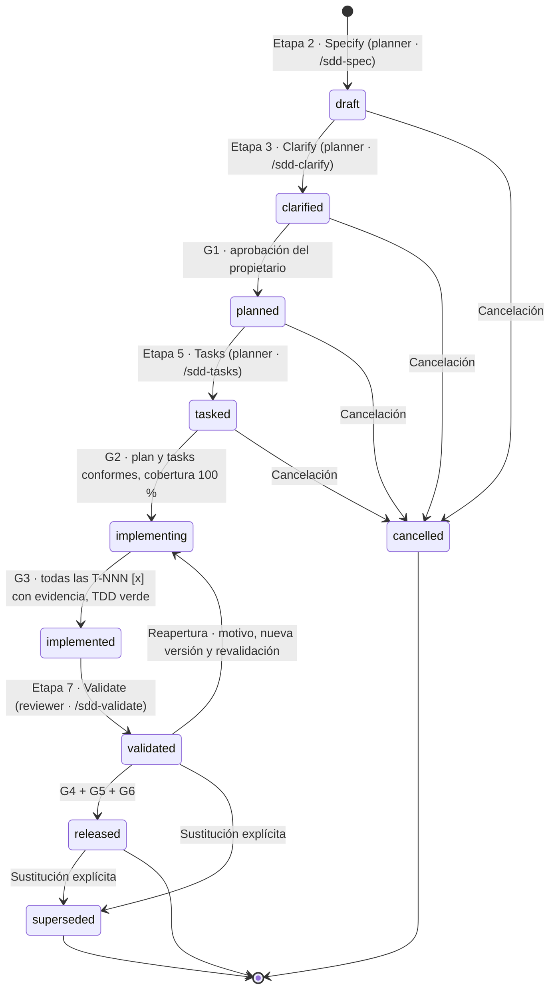

# Diagrama de flujo del ciclo de vida SDD

Documento derivado. La norma aplicable es `docs/constitution.md` y su desarrollo ejecutable en `docs/sdd/PROTOCOLO_OPERATIVO.md`; ante cualquier discrepancia prevalece la norma y este diagrama debe corregirse.

- Alcance: ciclo completo de una spec, desde su creación hasta su liberación, incluidas las seis compuertas y los estados terminales.
- Modelo: SDD Spec-Anchored (`docs/constitution.md:9`).
- Fuentes: `docs/sdd/PROTOCOLO_OPERATIVO.md:13-44`, `:61-67`, `:114-120`; `.opencode/agents/sdd.md:84-89`; `.opencode/commands/sdd-*.md`; `tools/sdd/validate.py`.

## 1. Jerarquía normativa

| Rango | Documento | Función |
|---|---|---|
| 1 | `docs/constitution.md` | Norma suprema, principios y guardrails |
| 2 | `AGENTS.md` | Reglas operativas para agentes |
| 3 | `docs/sdd/PROTOCOLO_OPERATIVO.md` | Norma SDD ejecutable |
| 4 | `docs/Flujo_de_Trabajo_Git.md` | Procedimiento Git |
| 5 | Documento maestro técnico | Hardware y benchmarks |
| 6 | `specs/NNN-slug/spec.md` | Contrato de la feature |
| 7 | `clarify.md`, `plan.md`, `tasks.md` | Decisiones y ejecución |
| 8 | `validation_report.md` | Evidencia de convergencia |
| 9 | Código | Implementación |

## 2. Etapas

| # | Etapa | Agente | Comando | Artefacto | Estado resultante |
|---|---|---|---|---|---|
| 1 | Constitución / Setup | propietario | — | `constitution.md`, `AGENTS.md`, agentes, skills | — |
| 2 | Specify | `planner` | `/sdd-spec` | `spec.md` | `draft` |
| 3 | Clarify | `planner` | `/sdd-clarify` | `clarify.md` + parches | `clarified` |
| 4 | Plan | `planner` | `/sdd-plan` | `plan.md` con `DEC-NNN` | `planned` |
| 5 | Tasks | `planner` | `/sdd-tasks` | `tasks.md` atómico | `tasked` |
| 6 | Implement (TDD) | `coder` | `/sdd-implement` | código + tests, una tarea por invocación | `implementing` → `implemented` |
| 7 | Validate | `reviewer` | `/sdd-validate` | `validation_report.md` | `validated` |

## 3. Flujo con compuertas

```mermaid
flowchart TD
    Start(["Nueva iniciativa"]) --> E1["<b>Etapa 1 · Constitución / Setup</b><br/>constitution.md · AGENTS.md · agentes · skills"]
    E1 --> E2["<b>Etapa 2 · Specify</b><br/>planner · /sdd-spec<br/>spec.md → draft"]
    E2 --> E3["<b>Etapa 3 · Clarify</b><br/>planner · /sdd-clarify<br/>clarify.md + parches → clarified"]
    E3 --> G1{"<b>G1</b><br/>¿spec.md sin ambigüedades,<br/>EARS correcto y línea<br/>- Approved by: Agent Sebaxtian?"}
    G1 -- "No · refinar" --> E3
    G1 -- "Sí · aprobada" --> E4["<b>Etapa 4 · Plan</b><br/>planner · /sdd-plan<br/>plan.md + DEC-NNN → planned"]
    E4 --> E5["<b>Etapa 5 · Tasks</b><br/>planner · /sdd-tasks<br/>tasks.md → tasked"]
    E5 --> G2{"<b>G2</b><br/>¿plan.md y tasks.md conformes<br/>y cobertura RF/CB → CA 100 %?"}
    G2 -- "No · ajustar" --> E4
    G2 -- "Sí · listo para código" --> E6["<b>Etapa 6 · Implement TDD</b><br/>coder · /sdd-implement<br/>una tarea por invocación"]
    E6 --> TDD["Red → Green → Refactor<br/>marcar [x] con evidencia"]
    TDD --> G3{"<b>G3</b><br/>¿todas las T-NNN [x]<br/>con evidencia y TDD verde?"}
    G3 -- "No · siguiente tarea" --> E6
    G3 -- "Sí · implementación completa" --> E7["<b>Etapa 7 · Validate</b><br/>reviewer · /sdd-validate<br/>validation_report.md"]
    E7 --> G4{"<b>G4</b><br/>¿reporte CONVERGIDO 100 %<br/>con filas PASADO y<br/>aprobación del propietario?"}
    G4 -- "No · corregir brechas" --> E6
    G4 -- "Sí · implementación validada" --> G5{"<b>G5</b><br/>¿merge --no-ff, validación<br/>posterior y rama eliminada?"}
    G5 -- "No · corregir integración" --> E7
    G5 -- "Sí · integrado en dev" --> G6{"<b>G6</b><br/>¿autorización, tag anotado,<br/>INDEX.md y CHANGELOG.md?"}
    G6 -- "No · completar release" --> G6
    G6 -- "Sí · publicado" --> Released(["released"])
    E7 -. "Reapertura: motivo + versión + revalidación" .-> E6
    Released -. "Sustitución explícita" .-> Superseded(["superseded"])
    E7 -. "Sustitución explícita" .-> Superseded
    G1 -. "Cancelación" .-> Cancelled(["cancelled"])
    G2 -. "Cancelación" .-> Cancelled
    classDef startEnd fill:#0F172A,stroke:#38BDF8,stroke-width:2.5px,color:#F8FAFC
    classDef etapa fill:#1D4ED8,stroke:#1E3A8A,stroke-width:2px,color:#FFFFFF
    classDef gate fill:#FFFBEB,stroke:#D97706,stroke-width:2px,color:#78350F
    classDef terminal fill:#047857,stroke:#064E3B,stroke-width:2px,color:#FFFFFF
    classDef cancelled fill:#BE123C,stroke:#881337,stroke-width:2px,color:#FFFFFF
    class Start,Released startEnd
    class E1,E2,E3,E4,E5,E6,TDD,E7 etapa
    class G1,G2,G3,G4,G5,G6 gate
    class Superseded terminal
    class Cancelled cancelled
```

## 4. Estados y transiciones

Los diez estados admitidos son `draft`, `clarified`, `planned`, `tasked`, `implementing`, `implemented`, `validated`, `released`, `superseded` y `cancelled` (`tools/sdd/validate.py:25-36`). Las transiciones son solo hacia adelante; la reapertura exige motivo registrado, incremento de versión y revalidación completa; la sustitución requiere declaración explícita (`docs/sdd/PROTOCOLO_OPERATIVO.md:25-33`).

Una compuerta no es un estado: alcanzar `clarified` no demuestra G1 aprobada, ni `validated` demuestra G4.

## 5. Compuertas

| Compuerta | Momento | Condición | Firma del propietario | Registro |
|---|---|---|---|---|
| G1 | Fin de Clarify | Spec sin ambigüedades, EARS correcto | Sí | `## Aprobaciones` en `spec.md` |
| G2 | Fin de Tasks | Plan y tasks conformes, cobertura 100 % | No | Verificación |
| G3 | Fin de Implement | Todas las tareas `[x]` con evidencia, TDD verde | No | `tasks.md` |
| G4 | Fin de Validate | Reporte CONVERGIDO 100 %, matriz en PASADO | Sí | `## Aprobaciones` en `spec.md` |
| G5 | Integración Git | `merge --no-ff`, validación posterior, rama eliminada | No | Historial Git |
| G6 | Release | Tag anotado, `INDEX.md` y `CHANGELOG.md` actualizados | Sí | `CHANGELOG.md` |

Formato exacto de la firma: `- Approved by: Agent Sebaxtian` (`docs/sdd/PROTOCOLO_OPERATIVO.md:114-120`). Ningún agente puede aprobar su propia spec ni autorizar su implementación o release (`docs/constitution.md:59-64`).

## 6. Trazabilidad

Cadena obligatoria: `RF/CB → CA → T → evidencia → commit → merge → release`. Ningún requisito sin criterio de aceptación, ningún criterio sin tarea, ninguna tarea sin validación declarada (`docs/sdd/PROTOCOLO_OPERATIVO.md:61-67`).

## 7. Validador determinista

| Código | Significado |
|---|---|
| `0` | Válido; puede haber advertencias |
| `1` | Error de validación |
| `2` | Error de uso: sin argumentos, spec inexistente o `--gate` inválido |

| `--gate` | spec | clarify | plan | tasks | ¿exige `[x]`? | report |
|---|---|---|---|---|---|---|
| `G1` | sí | sí | — | — | — | — |
| `G2` | sí | sí | sí | sí | — | — |
| `G3` | sí | sí | sí | sí | sí | — |
| `G4` | sí | sí | sí | sí | — | sí |
| `G5` | sí | sí | sí | sí | — | sí |
| `G6` | sí | sí | sí | sí | — | sí |

El despacho es acumulativo por umbral numérico, no específico por compuerta (`tools/sdd/validate.py:557-563`).

## 8. Brechas entre la norma y la ejecución

| # | Brecha | Impacto |
|---|---|---|
| 1 | Las líneas `- Approved by:` no se verifican en G1, G4 ni G6 | Una spec puede superar la compuerta sin aprobación |
| 2 | G5 y G6 no tienen lógica propia; equivalen a G4 | No se comprueban merge, tag, rama, `INDEX.md` ni `CHANGELOG.md` |
| 3 | La ausencia de `clarify.md`, `plan.md` o `tasks.md` es advertencia, no error | G1 y G2 pueden pasar sin sus artefactos |
| 4 | Las transiciones de estado no se validan | Saltos como `draft → released` no se detectan |
| 5 | `implementing`, `implemented` y `validated` no los escribe ningún comando | Transiciones manuales no auditadas |
| 6 | La cobertura `RF/CB → CA` es advertencia | Requisito sin criterio no bloquea |
| 7 | La cadena `CA → T` no se rastrea | Criterio huérfano no se detecta |
| 8 | La matriz del reporte solo se revisa en tablas reconocidas | Reporte sin matriz puede pasar |
| 9 | `--git` no verifica el alcance del diff | Cambios fuera de alcance no se detectan |
| 10 | `supersedes` y `superseded_by` no son obligatorios | Sustitución no verificada |
| 11 | `--all` no ejecuta la comprobación de tareas `[x]` | Spec `tasked` con tareas abiertas pasa |
| 12 | `INDEX.md` solo se verifica por existencia | Registro desactualizado no se detecta |
| 13 | `sdd-implement.md` cita G4 donde corresponde G2 | Confusión de compuerta en el comando |
| 14 | La plantilla de `spec.md` solo incluye casilla de G1 | G4 se añade ad hoc |
| 15 | `guia_maestra_sdd.md` no está indexado en `docs/sdd/README.md` | Documento de referencia fuera del orden de lectura |

## 9. Contradicción pendiente

`docs/sdd/PROTOCOLO_OPERATIVO.md:129` afirma que un cambio de requisito devuelve la spec a `draft`, lo que contradice las líneas `:29` y `:33` (transiciones solo hacia adelante y reapertura `validated → implementing`). Este diagrama sigue la regla de avance y reapertura; la discrepancia requiere una spec correctiva y no se dibuja.

## 10. Documentos relacionados

- `docs/sdd/PROTOCOLO_OPERATIVO.md` — norma ejecutable.
- `docs/sdd/diagrama_secuencia_subagentes_sdd.md` — interacción entre orquestador y subagentes.
- `docs/sdd/mapa_mental_sdd.md` — panorama conceptual.
- `docs/Flujo_de_Trabajo_Git.md` — ramas, integración y release.

Este documento sustituye el diagrama parcial que solo cubría G1–G4.
