# Ciclo de Vida SDD Puro (7 Etapas)

> **Documento de referencia (no normativo).** Ante contradicción prevalece `PROTOCOLO_OPERATIVO.md`, y por encima `AGENTS.md` y `docs/constitution.md`.

Diagrama de flujo con compuertas de validación, trazabilidad de artefactos y bucle TDD agéntico para el Desarrollo Basado en Especificaciones (SDD).

```mermaid
%% ============================================================================
%% TÍTULO: Ciclo de Vida SDD Puro (7 Etapas) - Diagrama de Flujo y Validación
%% DESCRIPCIÓN: Flujo secuencial con compuertas QA, bucle TDD y trazabilidad
%% ============================================================================
flowchart TD
    Start(["Inicio: Nueva Iniciativa / Feature"]):::startEnd

    %% ETAPA 1
    E1["<b>Etapa 1: Constitución y Setup</b><br/>• docs/constitution.md (Leyes e innegociables)<br/>• AGENTS.md (System Prompt, linters y guardrails)"]:::etapaBase

    %% ETAPA 2
    E2["<b>Etapa 2: Especificación (Specify)</b><br/>• specs/NNN-slug/spec.md<br/>• Define el QUÉ y POR QUÉ (Notación EARS)<br/>• Aislado de código e infraestructura"]:::etapaSpec

    %% ETAPA 3 + COMPUERTA QA
    E3["<b>Etapa 3: Clarificación (Clarify)</b><br/>• specs/NNN-slug/clarify.md<br/>• Auditoría QA previa a la arquitectura<br/>• Resolución de vacíos y casos borde (Q&A)"]:::etapaSpec
    G1{"¿Spec completa,<br/>clara y sin<br/>ambigüedades?"}:::gate

    %% ETAPA 4
    E4["<b>Etapa 4: Planificación (Plan)</b><br/>• specs/NNN-slug/plan.md<br/>• Define el CÓMO técnico y arquitectura<br/>• JSON Schema, contratos API y ADRs"]:::etapaPlan

    %% ETAPA 5 + COMPUERTA ARQUITECTURA
    E5["<b>Etapa 5: Tareas (Tasks)</b><br/>• specs/NNN-slug/tasks.md<br/>• Unidades atómicas por dependencias<br/>• Checkboxes ejecutables (15-30 min)"]:::etapaPlan
    G2{"¿Plan y tareas<br/>cumplen la<br/>Constitución?"}:::gate

    %% ETAPA 6: BUCLE TDD AGÉNTICO
    subgraph TDD ["Etapa 6: Implementación (Bucle TDD Agéntico)"]
        direction TB
        T_Red["<b>Fase Roja</b><br/>Escribir test unitario que falla"]:::tddRed
        T_Green["<b>Fase Verde</b><br/>Implementar código mínimo para pasar"]:::tddGreen
        T_Ref["<b>Refactorización</b><br/>Optimizar código y marcar casilla [x]"]:::tddRef
        G3{"¿Quedan tareas<br/>pendientes en<br/>tasks.md?"}:::gate

        T_Red --> T_Green --> T_Ref --> G3
        G3 -- "Sí (Siguiente tarea)" --> T_Red
    end

    %% ETAPA 7 + COMPUERTA CONVERGENCIA
    E7["<b>Etapa 7: Validación (Validate)</b><br/>• specs/NNN-slug/validation_report.md<br/>• Matriz de trazabilidad de requisitos<br/>• Contract testing y validación E2E"]:::etapaVal
    G4{"¿Convergencia<br/>certificada<br/>al 100%?"}:::gate

    End(["Fin: Código Certificado y Sincronizado en Git"]):::startEnd

    %% CONEXIONES PRINCIPALES
    Start --> E1
    E1 --> E2
    E2 --> E3
    E3 --> G1
    G1 -- "No (Refinar Q&A)" --> E2
    G1 -- "Sí (Spec Aprobada)" --> E4
    E4 --> E5
    E5 --> G2
    G2 -- "No (Ajustar diseño)" --> E4
    G2 -- "Sí (Listo para código)" --> T_Red
    G3 -- "No (100% tareas [x])" --> E7
    E7 --> G4
    G4 -- "No (Corregir brechas)" --> T_Red
    G4 -- "Sí (Aprobado)" --> End

    %% ESTILOS Y PALETA DE COLORES
    classDef startEnd fill:#0F172A,stroke:#38BDF8,stroke-width:2.5px,color:#F8FAFC
    classDef etapaBase fill:#1D4ED8,stroke:#1E3A8A,stroke-width:2px,color:#FFFFFF
    classDef etapaSpec fill:#6D28D9,stroke:#4C1D95,stroke-width:2px,color:#FFFFFF
    classDef etapaPlan fill:#B45309,stroke:#78350F,stroke-width:2px,color:#FFFFFF
    classDef etapaVal fill:#047857,stroke:#064E3B,stroke-width:2px,color:#FFFFFF
    classDef gate fill:#FFFBEB,stroke:#D97706,stroke-width:2px,color:#78350F
    classDef tddRed fill:#BE123C,stroke:#881337,stroke-width:2px,color:#FFFFFF
    classDef tddGreen fill:#047857,stroke:#064E3B,stroke-width:2px,color:#FFFFFF
    classDef tddRef fill:#1E293B,stroke:#475569,stroke-width:2px,color:#F8FAFC

    style TDD fill:#F8FAFC,stroke:#94A3B8,stroke-width:2px,stroke-dasharray: 5 5,color:#0F172A
```

