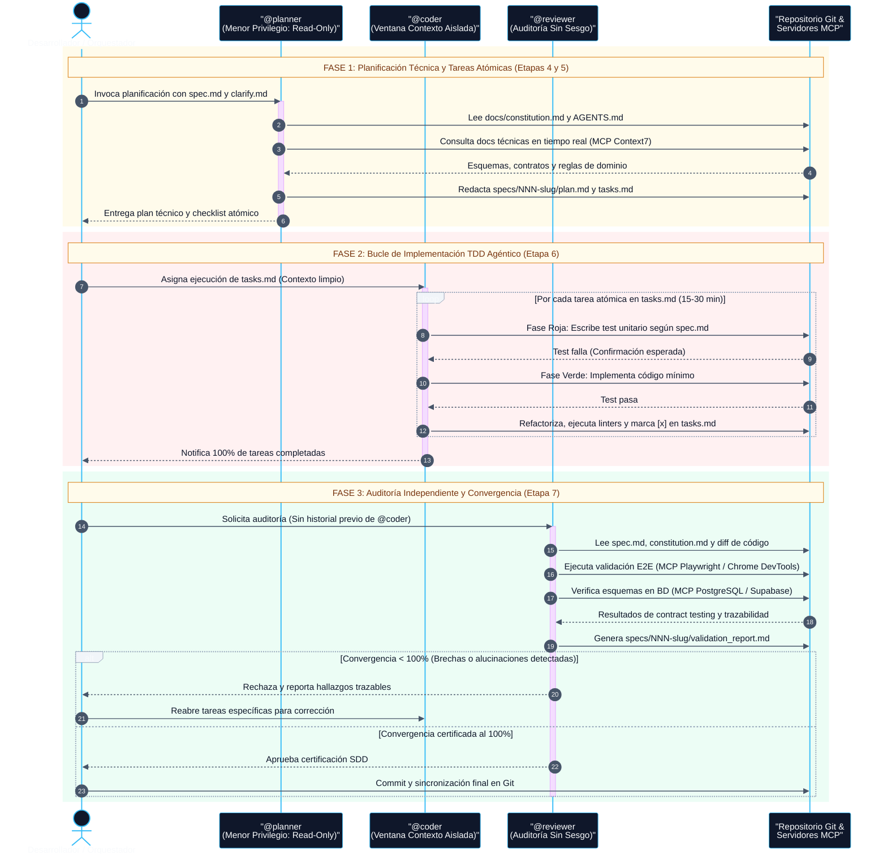

# Interacción de Subagentes en OpenCode (`@planner`, `@coder`, `@reviewer`)

> **Documento de referencia (no normativo).** Ante contradicción prevalece `PROTOCOLO_OPERATIVO.md`, y por encima `AGENTS.md` y `docs/constitution.md`.

Diagrama de secuencia que ilustra el aislamiento de ventanas de contexto, el principio de menor privilegio, el bucle TDD agéntico y la integración con servidores MCP dentro del ciclo SDD.

