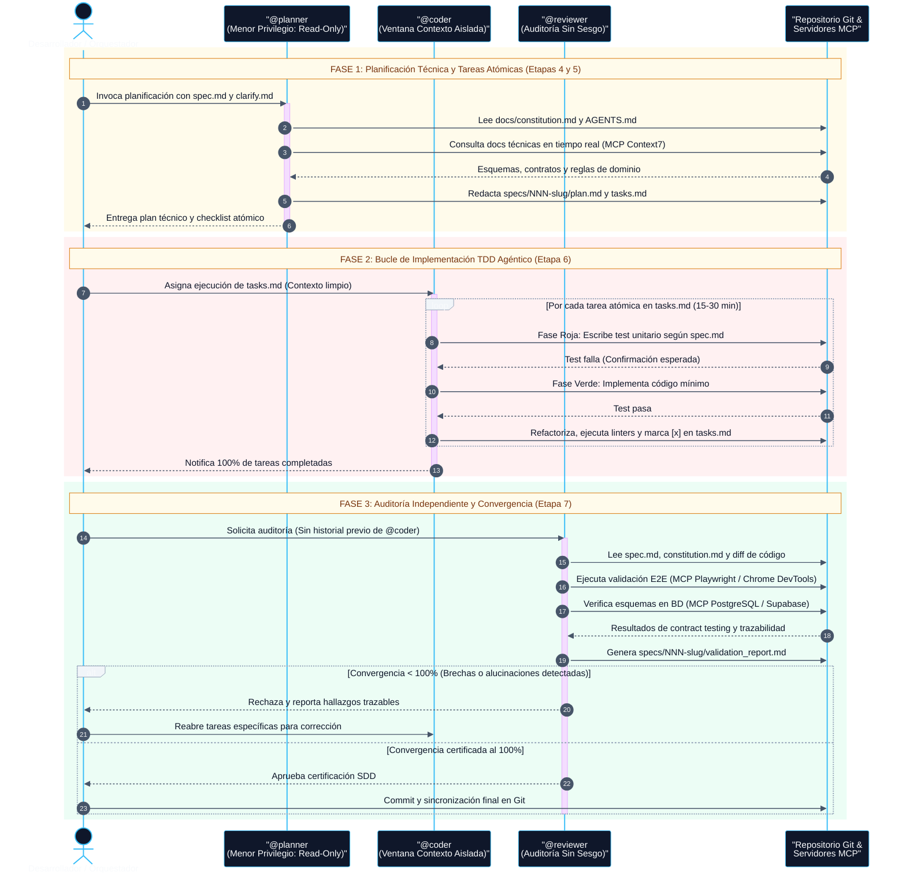

# Guía Maestra: Desarrollo Basado en Especificaciones (SDD)

> **Documento de referencia (no normativo).** Ante contradicción prevalece `PROTOCOLO_OPERATIVO.md`, y por encima `AGENTS.md` y `docs/constitution.md`.

Documentación visual completa sobre la arquitectura, metodología, ciclo de vida y orquestación agéntica del **Desarrollo Basado en Especificaciones (SDD)**.

## Índice de Diagramas

1. [Mapa Mental Completo (Arquitectura Conceptual)](#1-mapa-mental-completo-arquitectura-conceptual)
2. [Diagrama de Flujo: Ciclo de Vida SDD Puro (7 Etapas)](#2-diagrama-de-flujo-ciclo-de-vida-sdd-puro-7-etapas)
3. [Diagrama de Secuencia: Orquestación de Subagentes en OpenCode](#3-diagrama-de-secuencia-orquestación-de-subagentes-en-opencode)

---

## 1. Mapa Mental Completo (Arquitectura Conceptual)

Visión panorámica de los 5 pilares del SDD: fundamentos filosóficos, taxonomía de adopción, ciclo de vida de 7 etapas, notación EARS y ecosistema agéntico.

```mermaid
%% ============================================================================
%% TÍTULO: Desarrollo Basado en Especificaciones (SDD) - Mapa Mental Completo
%% DESCRIPCIÓN: Fundamentos, Taxonomía, Ciclo de Vida (7 Etapas), EARS y OpenCode
%% ============================================================================
%%{init: {
  'theme': 'base',
  'themeVariables': {
    'lineColor': '#64748B',
    'cScale0': '#0F172A',
    'cScaleLabel0': '#F8FAFC',
    'cScale1': '#1D4ED8',
    'cScaleLabel1': '#FFFFFF',
    'cScale2': '#047857',
    'cScaleLabel2': '#FFFFFF',
    'cScale3': '#B45309',
    'cScaleLabel3': '#FFFFFF',
    'cScale4': '#6D28D9',
    'cScaleLabel4': '#FFFFFF',
    'cScale5': '#BE123C',
    'cScaleLabel5': '#FFFFFF'
  }
}}%%
mindmap
  root((Desarrollo Basado en Especificaciones SDD))
    ["Fundamentos y Filosofía"]
      Definición
        Especificación como fuente única de verdad
        Legible por humanos y máquinas
        Separación estricta QUÉ vs CÓMO
      Fin del Vibe Coding
        Cero alucinaciones
        Eliminación del Intent Drift
        Control determinista sobre agentes de IA

    ["Taxonomía de Adopción"]
      Spec-First
        Arranca el desarrollo
        Código manda post-generación
        Ideal para PoCs y prototipos
      Spec-Anchored
        Recomendado para Enterprise
        Spec y código coexisten y evolucionan
        Sincronización continua en Git
      Spec-as-Source
        Spec es la única fuente editada
        Código compilado al 100%
        ("Ideal para SDKs (ej. Fern, TypeSpec)")

    ["Ciclo de Vida SDD Puro (7 Etapas)"]
      ("Etapa 1: Constitución y Setup")
        ("docs/constitution.md")
          Leyes fundamentales e innegociables
          Aislamiento de dominio
        ("AGENTS.md")
          System Prompt del repositorio
          ("Comandos, linters y guardrails")
      ("Etapa 2: Especificación (Specify)")
        ("specs/NNN-slug/spec.md")
          Define el QUÉ y POR QUÉ
          Notación EARS obligatoria
          Aislado de código e infraestructura
      ("Etapa 3: Clarificación (Clarify)")
        ("specs/NNN-slug/clarify.md")
          Auditoría QA previa a la arquitectura
          Detección de vacíos y ambigüedades
          ("Resolución de casos borde (Q&A)")
      ("Etapa 4: Planificación (Plan)")
        ("specs/NNN-slug/plan.md")
          Define el CÓMO técnico
          Estructura de módulos y rutas
          Esquemas JSON Schema y contratos API
          ADRs y decisiones técnicas
      ("Etapa 5: Tareas (Tasks)")
        ("specs/NNN-slug/tasks.md")
          Desglose en unidades atómicas
          Secuencia por dependencias
          ("Checkboxes ejecutables (15-30 min)")
      ("Etapa 6: Implementación (Implement)")
        Bucle TDD agéntico
          ("Fase Roja: Test unitario falla")
          ("Fase Verde: Código mínimo pasa")
          ("Refactor y marcado de casilla [x]")
      ("Etapa 7: Validación (Validate)")
        ("specs/NNN-slug/validation_report.md")
          Matriz de trazabilidad de requisitos
          Contract testing
          Certificación de convergencia al 100%

    ["Método EARS de Requisitos"]
      Reglas Generales
        Sujeto del sistema explícito
        Orden temporal estricto
      Los 5 Patrones
        ("Ubicuo: El sistema debe...")
        ("Evento: Cuando evento, el sistema debe...")
        ("Estado: Mientras estado, el sistema debe...")
        ("Opcional: Donde opción, el sistema debe...")
        ("Excepción: Si error, entonces el sistema debe...")
      Requisitos Complejos
        ("Combinación: Mientras + Cuando + Debe")

    ["Ecosistema Agéntico y OpenCode"]
      Subagentes Especializados
        Ventana de contexto aislada
        ("Menor privilegio (ej. read-only)")
        ("@planner: Redacta plan y tareas")
        ("@coder: Ejecuta bucle TDD")
        ("@reviewer: Audita sin sesgo")
      ("Skills (Habilidades)")
        Principio Progressive Disclosure
          ("Indexación liviana (~50 tokens)")
          ("Carga bajo demanda en skill.md")
        ("Estándares (ej. local-dates, TDD)")
      ("Servidores MCP (Model Context Protocol)")
        ("Transporte stdio local o SSE/HTTP remoto")
        ("Context7: Documentación técnica en tiempo real")
        ("Chrome DevTools y Playwright: Validación E2E")
        ("Bases de datos: PostgreSQL, Supabase")
```

---

## 2. Diagrama de Flujo: Ciclo de Vida SDD Puro (7 Etapas)

Flujo operativo secuencial desde la constitución del repositorio hasta la certificación de convergencia al 100%, incluyendo compuertas de control QA y el bucle TDD agéntico.

```mermaid
%% ============================================================================
%% TÍTULO: Ciclo de Vida SDD Puro (7 Etapas) - Diagrama de Flujo y Validación
%% DESCRIPCIÓN: Flujo secuencial con compuertas QA, bucle TDD y trazabilidad
%% ============================================================================
flowchart TD
    Start(["Inicio: Nueva Iniciativa / Feature"]):::startEnd

    %% ETAPA 1
    E1["<b>Etapa 1: Constitución y Setup</b><br/>• docs/constitution.md (Leyes e innegociables)<br/>• AGENTS.md (System Prompt, linters y guardrails)"]:::etapaBase

    %% ETAPA 2
    E2["<b>Etapa 2: Especificación (Specify)</b><br/>• specs/NNN-slug/spec.md<br/>• Define el QUÉ y POR QUÉ (Notación EARS)<br/>• Aislado de código e infraestructura"]:::etapaSpec

    %% ETAPA 3 + COMPUERTA QA
    E3["<b>Etapa 3: Clarificación (Clarify)</b><br/>• specs/NNN-slug/clarify.md<br/>• Auditoría QA previa a la arquitectura<br/>• Resolución de vacíos y casos borde (Q&A)"]:::etapaSpec
    G1{"¿Spec completa,<br/>clara y sin<br/>ambigüedades?"}:::gate

    %% ETAPA 4
    E4["<b>Etapa 4: Planificación (Plan)</b><br/>• specs/NNN-slug/plan.md<br/>• Define el CÓMO técnico y arquitectura<br/>• JSON Schema, contratos API y ADRs"]:::etapaPlan

    %% ETAPA 5 + COMPUERTA ARQUITECTURA
    E5["<b>Etapa 5: Tareas (Tasks)</b><br/>• specs/NNN-slug/tasks.md<br/>• Unidades atómicas por dependencias<br/>• Checkboxes ejecutables (15-30 min)"]:::etapaPlan
    G2{"¿Plan y tareas<br/>cumplen la<br/>Constitución?"}:::gate

    %% ETAPA 6: BUCLE TDD AGÉNTICO
    subgraph TDD ["Etapa 6: Implementación (Bucle TDD Agéntico)"]
        direction TB
        T_Red["<b>Fase Roja</b><br/>Escribir test unitario que falla"]:::tddRed
        T_Green["<b>Fase Verde</b><br/>Implementar código mínimo para pasar"]:::tddGreen
        T_Ref["<b>Refactorización</b><br/>Optimizar código y marcar casilla [x]"]:::tddRef
        G3{"¿Quedan tareas<br/>pendientes en<br/>tasks.md?"}:::gate

        T_Red --> T_Green --> T_Ref --> G3
        G3 -- "Sí (Siguiente tarea)" --> T_Red
    end

    %% ETAPA 7 + COMPUERTA CONVERGENCIA
    E7["<b>Etapa 7: Validación (Validate)</b><br/>• specs/NNN-slug/validation_report.md<br/>• Matriz de trazabilidad de requisitos<br/>• Contract testing y validación E2E"]:::etapaVal
    G4{"¿Convergencia<br/>certificada<br/>al 100%?"}:::gate

    End(["Fin: Código Certificado y Sincronizado en Git"]):::startEnd

    %% CONEXIONES PRINCIPALES
    Start --> E1
    E1 --> E2
    E2 --> E3
    E3 --> G1
    G1 -- "No (Refinar Q&A)" --> E2
    G1 -- "Sí (Spec Aprobada)" --> E4
    E4 --> E5
    E5 --> G2
    G2 -- "No (Ajustar diseño)" --> E4
    G2 -- "Sí (Listo para código)" --> T_Red
    G3 -- "No (100% tareas [x])" --> E7
    E7 --> G4
    G4 -- "No (Corregir brechas)" --> T_Red
    G4 -- "Sí (Aprobado)" --> End

    %% ESTILOS Y PALETA DE COLORES
    classDef startEnd fill:#0F172A,stroke:#38BDF8,stroke-width:2.5px,color:#F8FAFC
    classDef etapaBase fill:#1D4ED8,stroke:#1E3A8A,stroke-width:2px,color:#FFFFFF
    classDef etapaSpec fill:#6D28D9,stroke:#4C1D95,stroke-width:2px,color:#FFFFFF
    classDef etapaPlan fill:#B45309,stroke:#78350F,stroke-width:2px,color:#FFFFFF
    classDef etapaVal fill:#047857,stroke:#064E3B,stroke-width:2px,color:#FFFFFF
    classDef gate fill:#FFFBEB,stroke:#D97706,stroke-width:2px,color:#78350F
    classDef tddRed fill:#BE123C,stroke:#881337,stroke-width:2px,color:#FFFFFF
    classDef tddGreen fill:#047857,stroke:#064E3B,stroke-width:2px,color:#FFFFFF
    classDef tddRef fill:#1E293B,stroke:#475569,stroke-width:2px,color:#F8FAFC

    style TDD fill:#F8FAFC,stroke:#94A3B8,stroke-width:2px,stroke-dasharray: 5 5,color:#0F172A
```

---

## 3. Diagrama de Secuencia: Orquestación de Subagentes en OpenCode

Protocolo de ejecución entre `@planner`, `@coder` y `@reviewer` con aislamiento de contexto, principio de menor privilegio y verificación externa mediante servidores MCP.

