# Desarrollo Basado en Especificaciones (SDD)

> **Documento de referencia (no normativo).** Ante contradicción prevalece `PROTOCOLO_OPERATIVO.md`, y por encima `AGENTS.md` y `docs/constitution.md`.

Mapa mental estructurado sobre los fundamentos, taxonomía de adopción, ciclo de vida de 7 etapas, notación EARS y ecosistema agéntico con OpenCode.

```mermaid
%% ============================================================================
%% TÍTULO: Desarrollo Basado en Especificaciones (SDD) - Mapa Mental Completo
%% DESCRIPCIÓN: Fundamentos, Taxonomía, Ciclo de Vida (7 Etapas), EARS y OpenCode
%% ============================================================================
%%{init: {
  'theme': 'base',
  'themeVariables': {
    'lineColor': '#64748B',
    'cScale0': '#0F172A',
    'cScaleLabel0': '#F8FAFC',
    'cScale1': '#1D4ED8',
    'cScaleLabel1': '#FFFFFF',
    'cScale2': '#047857',
    'cScaleLabel2': '#FFFFFF',
    'cScale3': '#B45309',
    'cScaleLabel3': '#FFFFFF',
    'cScale4': '#6D28D9',
    'cScaleLabel4': '#FFFFFF',
    'cScale5': '#BE123C',
    'cScaleLabel5': '#FFFFFF'
  }
}}%%
mindmap
  root((Desarrollo Basado en Especificaciones SDD))
    ["Fundamentos y Filosofía"]
      Definición
        Especificación como fuente única de verdad
        Legible por humanos y máquinas
        Separación estricta QUÉ vs CÓMO
      Fin del Vibe Coding
        Cero alucinaciones
        Eliminación del Intent Drift
        Control determinista sobre agentes de IA

    ["Taxonomía de Adopción"]
      Spec-First
        Arranca el desarrollo
        Código manda post-generación
        Ideal para PoCs y prototipos
      Spec-Anchored
        Recomendado para Enterprise
        Spec y código coexisten y evolucionan
        Sincronización continua en Git
      Spec-as-Source
        Spec es la única fuente editada
        Código compilado al 100%
        ("Ideal para SDKs (ej. Fern, TypeSpec)")

    ["Ciclo de Vida SDD Puro (7 Etapas)"]
      ("Etapa 1: Constitución y Setup")
        ("docs/constitution.md")
          Leyes fundamentales e innegociables
          Aislamiento de dominio
        ("AGENTS.md")
          System Prompt del repositorio
          ("Comandos, linters y guardrails")
      ("Etapa 2: Especificación (Specify)")
        ("specs/NNN-slug/spec.md")
          Define el QUÉ y POR QUÉ
          Notación EARS obligatoria
          Aislado de código e infraestructura
      ("Etapa 3: Clarificación (Clarify)")
        ("specs/NNN-slug/clarify.md")
          Auditoría QA previa a la arquitectura
          Detección de vacíos y ambigüedades
          ("Resolución de casos borde (Q&A)")
      ("Etapa 4: Planificación (Plan)")
        ("specs/NNN-slug/plan.md")
          Define el CÓMO técnico
          Estructura de módulos y rutas
          Esquemas JSON Schema y contratos API
          ADRs y decisiones técnicas
      ("Etapa 5: Tareas (Tasks)")
        ("specs/NNN-slug/tasks.md")
          Desglose en unidades atómicas
          Secuencia por dependencias
          ("Checkboxes ejecutables (15-30 min)")
      ("Etapa 6: Implementación (Implement)")
        Bucle TDD agéntico
          ("Fase Roja: Test unitario falla")
          ("Fase Verde: Código mínimo pasa")
          ("Refactor y marcado de casilla [x]")
      ("Etapa 7: Validación (Validate)")
        ("specs/NNN-slug/validation_report.md")
          Matriz de trazabilidad de requisitos
          Contract testing
          Certificación de convergencia al 100%

    ["Método EARS de Requisitos"]
      Reglas Generales
        Sujeto del sistema explícito
        Orden temporal estricto
      Los 5 Patrones
        ("Ubicuo: El sistema debe...")
        ("Evento: Cuando evento, el sistema debe...")
        ("Estado: Mientras estado, el sistema debe...")
        ("Opcional: Donde opción, el sistema debe...")
        ("Excepción: Si error, entonces el sistema debe...")
      Requisitos Complejos
        ("Combinación: Mientras + Cuando + Debe")

    ["Ecosistema Agéntico y OpenCode"]
      Subagentes Especializados
        Ventana de contexto aislada
        ("Menor privilegio (ej. read-only)")
        ("@planner: Redacta plan y tareas")
        ("@coder: Ejecuta bucle TDD")
        ("@reviewer: Audita sin sesgo")
      ("Skills (Habilidades)")
        Principio Progressive Disclosure
          ("Indexación liviana (~50 tokens)")
          ("Carga bajo demanda en skill.md")
        ("Estándares (ej. local-dates, TDD)")
      ("Servidores MCP (Model Context Protocol)")
        ("Transporte stdio local o SSE/HTTP remoto")
        ("Context7: Documentación técnica en tiempo real")
        ("Chrome DevTools y Playwright: Validación E2E")
        ("Bases de datos: PostgreSQL, Supabase")
```

